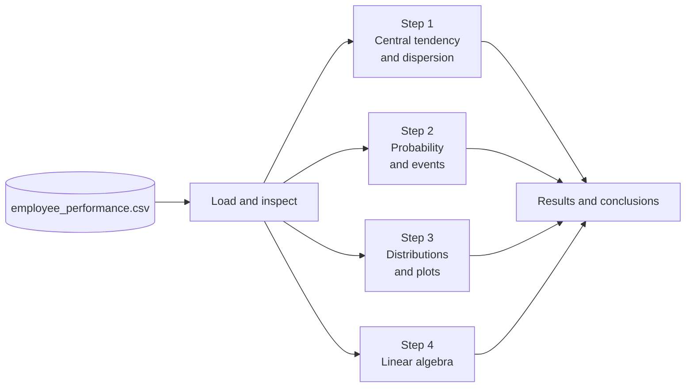
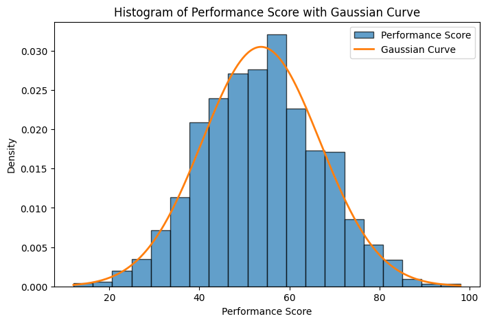
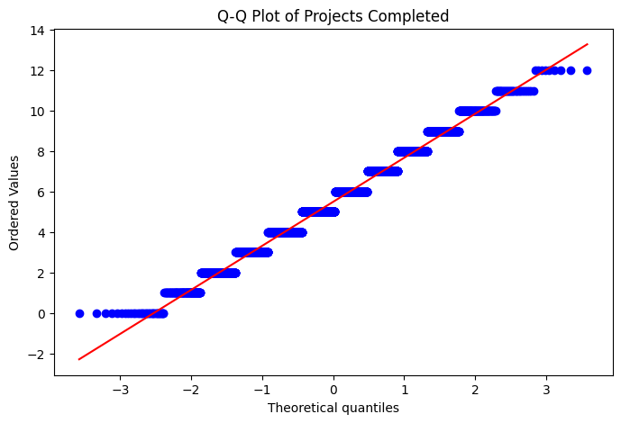

<div align="center">

<br>

# Employee Performance Analysis

### Statistics, probability and linear algebra, applied to 4,000 employee records.

A Python and Jupyter project that explores salaries, workload, performance scores and promotion outcomes through descriptive statistics, conditional probability, distribution analysis and vector mathematics.

<br>


<br>

[Overview](#overview) · [Highlights](#highlights) · [Dataset](#dataset) · [Results](#results) · [Visuals](#visual-showcase) · [Run it](#getting-started) · [Structure](#project-structure) · [Limitations](#limitations)

<br>

</div>

---

## Overview

This project was built for the **Maths & Advanced Statistics** module at **Red & White Multimedia Education**. It answers a single business question:

> *How do salary, workload and performance relate to promotion, and what can statistics tell us about it?*

The work is split into two parts:

| Part | Focus | Deliverable |
|---|---|---|
| **A: Theory** | 8 short-answer questions (central tendency, dispersion, distributions, skewness, conditional probability, independence, Bayes' theorem, PCA) | Word report |
| **B: Practical** | 4 hands-on steps in Python | Jupyter notebook, graphs, rough-work PDF |

> [!IMPORTANT]
> **The dataset is synthetic.** It was generated reproducibly (NumPy, seed `42`) and is **not** real employee data. All figures below are *sample results from that dataset*. Associations in it are partly built in by the generator, so they must not be read as findings about real people.

---

## Highlights

<table>
<tr>
<td width="25%" valign="top">

**Central tendency & dispersion**

Mean, median and mode of salary. Variance and standard deviation of projects completed.

</td>
<td width="25%" valign="top">

**Probability & events**

Overall promotion probability, a department contingency table, and P(Promotion | Score &gt; 80).

</td>
<td width="25%" valign="top">

**Distributions & visuals**

Performance-score histogram with Gaussian curve, salary skewness and kurtosis, and a Q-Q plot of projects.

</td>
<td width="25%" valign="top">

**Linear algebra**

Dot product, L1 and L2 norms, and the angle between employee work vectors.

</td>
</tr>
</table>

---

## Dataset

**File:** `Data/employee_performance.csv` · **Shape:** 4,000 rows × 8 columns · **Origin:** synthetic, seed `42`

| Column | Type | Meaning |
|---|---|---|
| `Employee_ID` | string | Unique identifier (e.g. `EMP0001`) |
| `Department` | categorical | HR, IT, Sales, Finance, Marketing, Operations |
| `Age` | integer | Age in years (observed 21–60) |
| `Salary` | integer | Salary amount (observed 22,000–112,800). Currency symbol and pay period are not stored in the file |
| `Projects_Completed` | integer | Projects completed (observed 0–12) |
| `Working_Hours` | integer | Working-hours measure (observed 20–61). Period not specified |
| `Performance_Score` | integer | Score from 0 to 100 (observed 12–98) |
| `Promotion_Status` | categorical | `Yes` or `No` |

### Data validation

Checks run directly on the CSV:

| Check | Result |
|---|---|
| Shape | 4,000 rows × 8 columns |
| Missing values | 0 |
| Duplicate rows | 0 |
| Duplicate `Employee_ID` values | 0 (`EMP0001` to `EMP4000`) |
| `Promotion_Status` values | `Yes` and `No` only |
| Departments | 6 (IT 1,025 · Operations 804 · Sales 784 · Marketing 506 · Finance 475 · HR 406) |

<details>
<summary><b>How the synthetic data was generated</b></summary>

<br>

> These are the generator's design parameters. Observed ranges in the table above are narrower where the clipping bounds were never reached.

- **Department** is sampled with probabilities HR 10%, IT 25%, Sales 20%, Finance 12%, Marketing 13%, Operations 20%.
- **Age** is drawn from a normal distribution (mean 35, sd 8), then clipped and rounded.
- **Salary** is a department base, plus an age adjustment of `(age − 35) × 650`, plus random noise, clipped to the range above.
- **Projects** come from a normal distribution (mean 5.5, sd 2.2), clipped and rounded.
- **Working hours** come from a normal distribution (mean 42, sd 6), clipped and rounded.
- **Performance score:**

```python
score = np.clip(
    np.rint(35 + projects * 3.2 + (hours - 40) * 0.35 + rng.normal(0, 11, n)),
    0, 100
).astype(int)
```

- **Promotion** is drawn from a logistic probability:

```python
logit = -4.2 + 0.055 * score + 0.10 * projects + 0.012 * (age - 30)
probability = 1 / (1 + np.exp(-logit))
promoted = rng.random(n) < probability
```

</details>

---

## Methodology



Each practical step in the notebook follows the same four-cell pattern: **question** (Markdown) → **solution** (Python) → **rough-work formulas** (Markdown) → **conclusion** (Markdown).

---

## Results

> **Verified.** Every value in this section was recomputed from `employee_performance.csv` and matches the saved outputs in the notebook.

### Step 1: Central tendency and dispersion

| Metric | Value |
|---|---|
| Salary mean | 53,575.12 |
| Salary median | 53,400.0 |
| Salary mode | 22,000 (appears 25 times) |
| Projects variance (sample, `ddof=1`) | ≈ 4.8207 |
| Projects standard deviation (sample) | ≈ 2.1956 |

> [!NOTE]
> The salary mode of 22,000 is also the **minimum salary in the file** (the generator's lower bound), so it reflects the synthetic rule rather than a typical salary.

### Step 2: Probability and events

$$P(\text{Promotion}) = \frac{1440}{4000} = 0.36 \quad (36\%)$$

$$P(\text{Promotion} \mid \text{Score} > 80) = \frac{62}{84} \approx 0.7381 \quad (73.81\%)$$

**Promotion by department**

| Department | No | Yes | Promotion rate |
|---|---:|---:|---:|
| Finance | 299 | 176 | 37.05% |
| HR | 253 | 153 | 37.68% |
| IT | 653 | 372 | 36.29% |
| Marketing | 336 | 170 | 33.60% |
| Operations | 507 | 297 | 36.94% |
| Sales | 512 | 272 | 34.69% |
| **Total** | **2,560** | **1,440** | **36.00%** |

*Rates are derived directly from the contingency counts above (Yes ÷ row total).*

### Step 3: Distribution shape (Salary)

| Statistic | Value | Reading |
|---|---:|---|
| Skewness (`bias=False`) | ≈ 0.1279 | Nearly symmetric, a very slight right tail |
| Excess kurtosis (`fisher=True, bias=False`) | ≈ −0.1553 | Marginally lighter tails than a normal curve |

These values do not by themselves prove normality.

### Step 4: Linear algebra

First five `[Projects_Completed, Working_Hours]` vectors: `[5, 49]`, `[5, 49]`, `[2, 50]`, `[5, 46]`, `[1, 42]`

| Operation (employees 1 and 2) | Result |
|---|---|
| Dot product | 25 + 2401 = **2426** |
| L1 norm of employee 1 | 5 + 49 = **54** |
| L2 norm of employee 1 | √2426 ≈ **49.2544** |
| Angle | cos⁻¹(1) = **0°** (the two vectors are identical) |

### Key insights

1. **About 36% of employees are promoted** in the sample (1,440 of 4,000).
2. **High scorers are promoted far more often.** About 73.81% of employees scoring above 80 were promoted, versus 36% overall. This is an observed conditional probability, and partly a product of how the data was generated.
3. **Department rates are close together** (roughly 34% to 38%). Raw counts favour IT only because IT has the most employees.
4. **Salary is close to symmetric**, with skewness near zero and slightly light tails.
5. **The 0° angle is a property of the first two rows**, not a general behavioural finding.

---

## Visual showcase

| Performance score histogram with Gaussian curve | Q-Q plot of projects completed |
|:---:|:---:|
|  |  |
| 20 bins, `density=True`, curve fitted with the sample mean (53.70) and standard deviation (13.08) | Observed project-count quantiles against theoretical normal quantiles |

**What they show**

- **Histogram:** scores are unimodal and roughly bell-shaped, peaking around 55–60 and tapering from about 12 to 98. The Gaussian curve fits closely, with the histogram sitting slightly above it near the peak.
- **Q-Q plot:** points follow the red reference line through the centre, so projects completed is approximately normal. Points appear as horizontal bands because the values are integers, and the lowest values (0 and 1) sit slightly above the line at the left tail.

---

## Getting started

**Requirements:** Python 3 and the libraries below.

```bash
pip install pandas numpy matplotlib scipy jupyter
```

**Run the notebook**

```bash
cd Notebook
jupyter notebook Employee_perormance_analysis.ipynb
```

Then choose **Run All**. The notebook loads the CSV in its third cell. Point it at your copy of the data, using a relative path so it works on any machine:

```python
df = pd.read_csv("../Data/employee_performance.csv")
```

> [!NOTE]
> The saved notebook currently loads the CSV from an absolute path on the author's own computer. Change that one line before running it elsewhere.

**Reproducibility notes**

- The CSV was generated with `numpy.random.default_rng(42)`, so the same generator and environment produce the same data.
- If you use your own CSV, replace the file in `Data/` and re-run everything. All numbers in this README will change.

---

## Project structure

```text
Employee_Performance_Analysis/
├── Data/
│   └── employee_performance.csv
├── Notebook/
│   └── Employee_perormance_analysis.ipynb
├── Report/
│   └── Part A Employee performance Analysis Theroy.docx
├── Visuals/
│   ├── Perforamance_score.png
│   └── Project_completed_q-q_plot.png
├── Rough Work/
│   └── Employee_Performance_Rough_Work.pdf
└── README.md
```

File names above are shown exactly as they exist, including the original spellings.

---

## Notebook and rough work

The notebook (`Employee_perormance_analysis.ipynb`) contains 15 executed code cells, with the original exam question in Markdown above each of the four steps, saved outputs, and a conclusion.

`Employee_Performance_Rough_Work.pdf` is a handwritten, 5-page worksheet covering:

- the salary mean, median and mode results, and worked examples for range, mean and variance;
- the promotion probability (1440 / 4000 = 0.36) and the department contingency table;
- the conditional probability 62 / 84 ≈ 0.7381 (73.81%);
- the dot product, L1 norm, L2 norm and angle for the first two employee vectors.

---

## Part A: theory topics

<details>
<summary><b>The eight theory questions covered in the Word report</b></summary>

<br>

1. Mean, median and mode, with a salary example
2. Range versus variance
3. Normal versus Poisson distribution
4. Skewness, with a workplace example
5. Conditional probability and promotions
6. Independent versus mutually exclusive events
7. Bayes' theorem in real-world decisions
8. Principal Component Analysis (PCA) in simple words

</details>

---

## Limitations

- **Synthetic data.** Results describe a generated sample, not a real workforce.
- **Association, not causation.** Relationships between score, projects and promotion were partly written into the generator.
- **Clipping effects.** Hard bounds (for example the minimum salary of 22,000) create artificial spikes.
- **Variance convention.** Practical code uses *sample* variance (`n − 1`); the small theory example uses *population* variance (`n`).
- **Undocumented units.** Salary period and working-hours period are not specified.

---

## Author

**[Tej Patel]** · Red & White Multimedia Education · Maths & Advanced Statistics

<div align="center">
<sub>Built with Python, pandas, NumPy, SciPy and Matplotlib.</sub>
</div>
